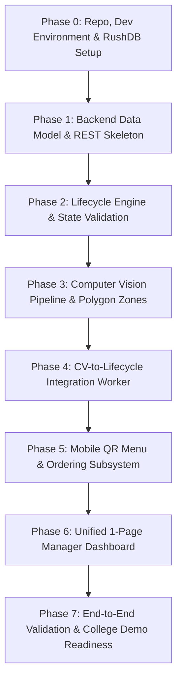

# Building.md
## Restaurant Intelligence & Operations System — Master Build & Implementation Plan

> **System Source of Truth:** This document defines the engineering execution blueprint, directory structure, data contracts, state machine logic, phase-by-phase task breakdown, and acceptance gates for building the MVP. It operationalizes [Defining.md](file:///d:/2026/college%20pro/rip%5B%20resturent%20%5D/Defining.md), [Designing.md](file:///d:/2026/college%20pro/rip%5B%20resturent%20%5D/Designing.md), and [restaurant_ai_mvp_tech_stack.md](file:///d:/2026/college%20pro/rip%5B%20resturent%20%5D/restaurant_ai_mvp_tech_stack.md).

---

## 1. System Overview & Core Directives

### 1.1 Product Mission
An AI-powered restaurant operations system that combines **CCTV video observation** and **table-specific QR ordering** into a single, unified operational view for the restaurant manager.

### 1.2 Technology Decisions (Locked)
- **Backend:** Python 3.11+, FastAPI, WebSockets, Pydantic v2, Uvicorn.
- **Computer Vision:** OpenCV, FFmpeg, YOLO (Ultralytics), ByteTrack, NumPy.
- **Database:** RushDB (Document/Graph NoSQL integration via official SDK/API). *No SQLite, no SQLAlchemy.*
- **Frontend:** React 18+, TypeScript, Vite, Tailwind CSS, Lucide Icons.
- **Color Tokens:**
  - `BORDO` (`#6C151E`): Attention required, guest left, awaiting cleaning.
  - `GREEN` (`#0F3D3A`): Safe / normal states (`FREE`, `GUEST_DINING`).
  - `CREAM` (`#F5DABF`): Primary dashboard canvas / background.

### 1.3 Key Architectural Boundaries
1. **Asynchronous Vision Worker:** The computer vision loop runs in a standalone worker process/thread and communicates observations via an internal queue or API. *Never run a blocking video loop inside a FastAPI request handler.*
2. **Deterministic Lifecycle vs. Probabilistic CV:** Computer vision outputs *probabilistic observations* (person presence, bounding box, track ID). The backend *Table Lifecycle Engine* applies debounce windows, smoothing, and validation to emit *deterministic state events*.
3. **Staff-Confirmed Cleaning:** CCTV does not infer cleaning in the MVP. Transition from `GUEST_LEFT` / `CLEANED` to `FREE` is explicitly triggered by manager/staff confirmation.
4. **Idempotent Ordering:** Orders are verified and prices calculated exclusively server-side. Order snapshots are immutable once placed.

---

## 2. Target Project Directory Structure

```text
rip-restaurant/
├── .env.example
├── .gitignore
├── README.md
├── Defining.md
├── Designing.md
├── Building.md
├── restaurant_ai_mvp_tech_stack.md
│
├── backend/
│   ├── pyproject.toml
│   ├── requirements.txt
│   ├── app/
│   │   ├── __init__.py
│   │   ├── main.py                 # FastAPI application factory & routes inclusion
│   │   ├── config.py               # App configuration & environment settings
│   │   ├── api/
│   │   │   ├── __init__.py
│   │   │   ├── restaurants.py      # Restaurant & floor metadata endpoints
│   │   │   ├── cameras.py          # Camera source management
│   │   │   ├── tables.py           # Table setup & zone polygons CRUD
│   │   │   ├── cycles.py           # Active/historical table cycle queries
│   │   │   ├── menu.py             # QR menu retrieval & category endpoints
│   │   │   ├── orders.py           # Order placement & manager acknowledgment
│   │   │   ├── actions.py          # Staff actions (confirm cleaning, manual override)
│   │   │   └── websocket.py        # Real-time WebSocket connection manager & broadcast
│   │   ├── models/
│   │   │   ├── __init__.py
│   │   │   ├── domain.py           # Enums: TableState, EventSource, OrderStatus
│   │   │   ├── schemas.py          # Pydantic request & response models
│   │   │   └── rushdb_models.py    # RushDB document schemas & entity adapters
│   │   ├── services/
│   │   │   ├── __init__.py
│   │   │   ├── rushdb_client.py    # Direct RushDB SDK connection wrapper
│   │   │   ├── lifecycle_engine.py # Table state machine & transition rules
│   │   │   ├── ordering_service.py # Menu validation, cart calculation, order creation
│   │   │   └── broadcaster.py      # WebSocket event broadcasting service
│   │   └── utils/
│   │       ├── __init__.py
│   │       └── logger.py           # Structured logging setup
│   └── tests/
│       ├── __init__.py
│       ├── conftest.py
│       ├── test_lifecycle.py       # State machine deterministic tests
│       ├── test_ordering.py        # Order validation & snapshot tests
│       └── test_api.py             # FastAPI endpoint integration tests
│
├── vision/
│   ├── requirements.txt
│   ├── run_worker.py               # Standalone CV worker entrypoint
│   ├── config.py                   # Model weights, camera URLs, thresholds
│   ├── core/
│   │   ├── __init__.py
│   │   ├── video_stream.py         # OpenCV / FFmpeg video capture & frame generator
│   │   ├── detector.py             # YOLO person detection wrapper
│   │   ├── tracker.py              # ByteTrack multi-object tracking integration
│   │   ├── geometry.py             # Point-in-polygon & footpoint calculations
│   │   ├── table_associator.py     # Maps person tracks to table polygon zones
│   │   ├── occupancy_filter.py     # Temporal debounce & occupancy smoothing
│   │   └── annotator.py            # Draws polygon overlays, timers, labels onto frames
│   └── test_assets/
│       ├── sample_restaurant.mp4   # Offline video for development & test runs
│       └── zones_config.json       # Sample table polygon coordinates
│
└── frontend/
    ├── package.json
    ├── tsconfig.json
    ├── vite.config.ts
    ├── tailwind.config.js
    ├── postcss.config.js
    ├── index.html
    └── src/
        ├── App.tsx                 # Route router: Manager Dashboard vs. Customer QR Menu
        ├── main.tsx
        ├── index.css               # Tailwind directives & design tokens
        ├── api/
        │   ├── client.ts           # Axios / Fetch HTTP API client
        │   └── ws.ts               # WebSocket connection & reconnect handler
        ├── types/
        │   └── index.ts            # TypeScript interfaces (Table, Cycle, Order, Event)
        ├── hooks/
        │   ├── useTables.ts        # Table status & live WebSocket sync
        │   ├── useSelectedTable.ts # Selection & cycle timeline loader
        │   └── useCart.ts          # Customer QR ordering cart state
        ├── components/
        │   ├── common/
        │   │   ├── Badge.tsx
        │   │   ├── Button.tsx
        │   │   └── StatusIndicator.tsx
        │   ├── dashboard/
        │   │   ├── CameraPanel.tsx       # Live/simulated feed with polygon canvas overlay
        │   │   ├── TableStatusList.tsx   # Right-side compact table overview
        │   │   ├── TableRow.tsx          # Single table item with status badge & timer
        │   │   ├── TableDetailPanel.tsx  # Selected table timeline, orders, clean button
        │   │   └── IncomingOrdersBar.tsx # Unacknowledged order alerts
        │   └── customer/
        │       ├── MenuHeader.tsx        # Restaurant title & Table ID badge
        │       ├── CategoryNav.tsx       # Horizontal category switcher
        │       ├── MenuItemCard.tsx      # Item details with add-to-cart stepper
        │       ├── CartDrawer.tsx        # Slide-over cart preview & total calculation
        │       └── OrderSuccessModal.tsx # Confirmation & table instructions
        └── pages/
            ├── ManagerDashboardPage.tsx  # Unified 1-page manager operations screen
            └── CustomerMenuPage.tsx      # Mobile-first QR ordering experience
```

---

## 3. Data Contracts & State Machine Specification

### 3.1 Table Lifecycle State Machine

```text
               ┌───────────────┐
               │     FREE      │◄─────────────────────────────┐
               └───────┬───────┘                              │
                       │ CV_ARRIVAL (Occupancy confirmed)     │
                       ▼                                      │
               ┌───────────────┐                              │
               │ GUEST_ARRIVED │                              │
               └───────┬───────┘                              │
                       │ QR_ORDER (First order submitted)     │
                       ▼                                      │
               ┌───────────────┐                              │
               │    ORDERED    │                              │
               └───────┬───────┘                              │
                       │ AUTO_DINING (Timer/occupancy active) │
                       ▼                                      │
               ┌───────────────┐                              │
               │ GUEST_DINING  │◄─────────────┐               │
               └───────┬───────┘              │               │
                       │                      │ Subsequent    │
                       │                      │ QR_ORDER      │
                       │                      │               │
                       │ CV_DEPARTURE (Window elapsed)        │
                       ▼                                      │
               ┌───────────────┐                              │
               │  GUEST_LEFT   │                              │
               └───────┬───────┘                              │
                       │ STAFF_CLEANED (Manager confirms)     │
                       ▼                                      │
               ┌───────────────┐                              │
               │    CLEANED    │──────────────────────────────┘
               └───────────────┘  Auto-transitions to FREE & closes cycle
```

#### Valid Transition Matrix

| Current State | Trigger / Event | New State | Guard Conditions / Rules |
|---|---|---|---|
| `FREE` | `CV_ARRIVAL` | `GUEST_ARRIVED` | New `TableCycle` created; occupancy > threshold duration. |
| `FREE` | `QR_ORDER` | `ORDERED` | Fallback if guests ordered before CV triggered. Creates cycle. |
| `GUEST_ARRIVED`| `QR_ORDER` | `ORDERED` | Order attached to active cycle; `first_order_at` recorded. |
| `GUEST_ARRIVED`| `CV_DEPARTURE`| `FREE` | False alarm / guest left without ordering; cycle cancelled. |
| `ORDERED` | `SYS_DINING` | `GUEST_DINING` | Transition after order acknowledgment or delay timer. |
| `GUEST_DINING` | `QR_ORDER` | `GUEST_DINING` | Additional orders attached to existing cycle. No state change. |
| `GUEST_DINING` | `CV_DEPARTURE`| `GUEST_LEFT` | Occupancy empty for departure confirmation window (e.g. 45s). |
| `GUEST_ARRIVED`| `CV_DEPARTURE` (late)| `GUEST_LEFT` | Guest seated but didn't order via QR and left. |
| `GUEST_LEFT` | `STAFF_CLEANED`| `CLEANED` -> `FREE`| Staff clicks "Confirm Cleaned"; cycle closed; table ready. |

---

### 3.2 Core Schemas & Payloads

#### Table Schema
```json
{
  "table_id": "T01",
  "display_name": "Table 1 (Window)",
  "capacity": 4,
  "camera_id": "CAM_01",
  "zone_polygon": [[120, 340], [280, 340], [290, 480], [110, 480]],
  "current_state": "GUEST_DINING",
  "current_cycle_id": "CYC_20261116_001",
  "occupancy_count": 3,
  "state_updated_at": "2026-11-16T11:42:00Z"
}
```

#### TableEvent Schema
```json
{
  "event_id": "EVT_987654",
  "cycle_id": "CYC_20261116_001",
  "table_id": "T01",
  "event_type": "GUEST_ARRIVED",
  "source": "computer_vision",
  "confidence": 0.88,
  "occurred_at": "2026-11-16T11:15:30Z",
  "metadata": { "tracked_ids": [101, 104, 105], "dwell_seconds": 12.5 }
}
```

#### Order Snapshot Schema
```json
{
  "order_id": "ORD_5501",
  "restaurant_id": "REST_01",
  "table_id": "T01",
  "cycle_id": "CYC_20261116_001",
  "status": "SUBMITTED",
  "items": [
    {
      "item_id": "ITEM_101",
      "name_snapshot": "Truffle Pasta",
      "price_snapshot": 18.50,
      "quantity": 2,
      "subtotal": 37.00
    }
  ],
  "subtotal": 37.00,
  "tax": 3.70,
  "total": 40.70,
  "submitted_at": "2026-11-16T11:22:15Z",
  "acknowledged_at": null
}
```

#### WebSocket Broadcast Envelope
```json
{
  "event": "table.state_changed",
  "timestamp": "2026-11-16T11:22:15Z",
  "payload": {
    "table_id": "T01",
    "previous_state": "GUEST_ARRIVED",
    "new_state": "ORDERED",
    "cycle_id": "CYC_20261116_001",
    "order_id": "ORD_5501",
    "color_token": "#0F3D3A"
  }
}
```

---

## 4. Phase-by-Phase Implementation Plan



---

### Phase 0 — Workspace Setup, Dependencies & RushDB Validation
**Duration:** Days 1–3  
**Objective:** Initialize monorepo, configure Python and React environments, verify RushDB authentication and CRUD operations, and freeze contracts.

#### Tasks:
- [ ] **Task 0.1: Monorepo & Git Initialization**
  - Initialize local git repository with standard `.gitignore` (ignoring `.env`, `node_modules`, `__pycache__`, `venv`, `runs`, `*.mp4`).
  - Create directory skeleton: `backend/`, `vision/`, `frontend/`, `data/`.
- [ ] **Task 0.2: Backend Python Environment**
  - Configure `backend/requirements.txt`:
    - `fastapi`, `uvicorn[standard]`, `pydantic>=2.0`, `requests`, `python-dotenv`, `pytest`, `httpx`.
  - Create `backend/app/config.py` loading environment variables via `pydantic-settings`.
- [ ] **Task 0.3: RushDB Connectivity Test**
  - Create `backend/services/rushdb_client.py`.
  - Write a standalone test script `backend/tests/test_rushdb_connection.py` to create a test collection, insert a record, query it, and delete it.
  - Verify RushDB credentials (`RUSHDB_API_KEY`, `RUSHDB_BASE_URL`).
- [ ] **Task 0.4: Frontend Scaffolding**
  - Initialize Vite React + TypeScript in `frontend/`.
  - Install dependencies: `tailwindcss`, `postcss`, `autoprefixer`, `lucide-react`, `axios`.
  - Setup Tailwind CSS with tokens:
    ```javascript
    colors: {
      bordo: '#6C151E',
      emerald_deep: '#0F3D3A',
      cream_bg: '#F5DABF',
    }
    ```
- [ ] **Task 0.5: Test Video Preparation**
  - Place a representative restaurant MP4 video into `vision/test_assets/sample_restaurant.mp4`.
  - Create initial `zones_config.json` with 3–4 polygon coordinates.

**Exit Gate:**
- `pytest backend/tests/test_rushdb_connection.py` passes.
- `frontend` runs with `npm run dev` displaying a styled canvas.
- Sample MP4 video is readable via OpenCV.

---

### Phase 1 — Data Foundation & Backend Skeleton
**Duration:** Days 4–7  
**Objective:** Establish core database models, REST API endpoints, and seed mock restaurant floor data.

#### Tasks:
- [ ] **Task 1.1: Domain Models & Pydantic Schemas**
  - Create `backend/app/models/domain.py` (`TableState`, `EventSource`, `OrderStatus`).
  - Create `backend/app/models/schemas.py` for Tables, Cycles, Events, Menu, and Orders.
- [ ] **Task 1.2: RushDB Entity Adapters**
  - Implement CRUD functions in `backend/app/services/rushdb_client.py` for:
    - Tables collection (`table_id`, `camera_id`, `zone_polygon`, `current_state`).
    - Cycles collection (`cycle_id`, `table_id`, `status`, `timeline`).
    - Menu collection (`categories`, `items`).
- [ ] **Task 1.3: Table & Cycle REST Endpoints**
  - Implement `backend/app/api/tables.py`:
    - `GET /api/tables`: List all tables with active state.
    - `POST /api/tables`: Register a table with polygon coordinates.
    - `GET /api/tables/{table_id}`: Get table details with active cycle.
  - Implement `backend/app/api/cycles.py`:
    - `GET /api/tables/{table_id}/cycles`: Get historical and current cycles.
- [ ] **Task 1.4: Database Seeding Script**
  - Create `backend/scripts/seed_data.py`:
    - Seed Restaurant "The College Bistro".
    - Seed 4 tables (`T01`, `T02`, `T03`, `T04`) with polygon coordinates.
    - Seed Menu with categories (Starters, Mains, Drinks) and 6 items with prices.

**Exit Gate:**
- Seeding script runs idempotently.
- `GET /api/tables` returns the 4 seeded tables from RushDB.

---

### Phase 2 — Table Lifecycle Engine (Deterministic Logic)
**Duration:** Days 8–11  
**Objective:** Implement the state machine and transition rules with unit tests, ensuring complete decoupling from CV and UI.

#### Tasks:
- [ ] **Task 2.1: Lifecycle Engine Service**
  - Create `backend/app/services/lifecycle_engine.py`.
  - Implement `handle_event(table_id: str, event_type: str, source: EventSource, metadata: dict) -> TableCycle`.
  - Implement guard checks:
    - Reject `GUEST_ARRIVED` if table is already `GUEST_DINING` or `ORDERED`.
    - Reject cleaning confirmation unless state is `GUEST_LEFT` or `CLEANED`.
- [ ] **Task 2.2: Cycle & Event Persistence**
  - Upon valid transition:
    - Append `TableEvent` to the active `TableCycle`.
    - Update `current_state` on the `Table` record in RushDB.
    - When `STAFF_CLEANED` occurs: mark cycle closed, record `closed_at`, set table to `FREE`.
- [ ] **Task 2.3: Lifecycle Test Suite (TDD)**
  - Write comprehensive tests in `backend/tests/test_lifecycle.py`:
    - `test_full_happy_path_cycle`: `FREE` -> `GUEST_ARRIVED` -> `ORDERED` -> `GUEST_DINING` -> `GUEST_LEFT` -> `CLEANED` -> `FREE`.
    - `test_invalid_transition_rejected`: e.g. `FREE` directly to `CLEANED`.
    - `test_multi_order_same_cycle`: Multiple orders keep cycle active without resetting arrival.
    - `test_guest_leaves_without_ordering`: Short visit cleanup.

**Exit Gate:**
- `pytest backend/tests/test_lifecycle.py` passes 100% without external camera or UI dependencies.

---

### Phase 3 — Computer Vision Prototype
**Duration:** Days 12–16  
**Objective:** Ingest video frames, detect persons using YOLO, track across frames with ByteTrack, and calculate polygon table occupancy.

#### Tasks:
- [ ] **Task 3.1: Video Stream Capture**
  - In `vision/core/video_stream.py`, create `VideoStream` class supporting both local `.mp4` and `rtsp://` streams.
  - Implement FPS-regulated frame extraction (e.g. process 5 frames per second to optimize CPU/GPU utilization).
- [ ] **Task 3.2: YOLO Person Detection**
  - In `vision/core/detector.py`, load `yolov8n.pt` (nano) or `yolov8s.pt`.
  - Filter detections strictly for `class_id == 0` (person) with confidence > 0.40.
- [ ] **Task 3.3: ByteTrack Integration**
  - In `vision/core/tracker.py`, wrap ByteTrack to assign consistent track IDs to detected persons.
- [ ] **Task 3.4: Table Zone Geometry Association**
  - In `vision/core/geometry.py`, implement `is_point_in_polygon(point, polygon)` using OpenCV `cv2.pointPolygonTest`.
  - Calculate person footpoint as `(x_center, y_bottom) = (bbox[0] + bbox[2]/2, bbox[3])`.
  - In `vision/core/table_associator.py`, map person track IDs to configured table polygons.
- [ ] **Task 3.5: Visual Annotation & Debug Viewer**
  - In `vision/core/annotator.py`, render:
    - Table polygons in GREEN (free) or BORDO (occupied).
    - Table ID labels and estimated occupant count.
    - Person bounding boxes with track IDs.
  - Test via a standalone script `python vision/run_worker.py --debug` showing `cv2.imshow` window.

**Exit Gate:**
- Visual script processes `sample_restaurant.mp4` smoothly.
- Moving persons walking through table polygons are correctly associated with the table.

---

### Phase 4 — CV-to-Lifecycle Integration
**Duration:** Days 17–20  
**Objective:** Bridge the CV worker to the backend lifecycle engine with temporal debouncing (smoothing) to eliminate false triggers.

#### Tasks:
- [ ] **Task 4.1: Occupancy Debounce Filter**
  - In `vision/core/occupancy_filter.py`:
    - **Arrival Trigger:** A table must have continuous occupancy detected for >= 5 seconds before emitting `CV_ARRIVAL`.
    - **Departure Trigger:** A table must be continuously empty for >= 30 seconds before emitting `CV_DEPARTURE`.
    - Handle temporary occlusions (person standing up briefly).
- [ ] **Task 4.2: CV Event Dispatcher**
  - When debounce criteria are met, send HTTP `POST /api/internal/cv-events` to the FastAPI backend.
  - Payload contains `table_id`, `event_type`, `estimated_count`, `timestamp`, `confidence`.
- [ ] **Task 4.3: WebSocket Live Broadcaster**
  - In `backend/app/api/websocket.py`, implement `ConnectionManager` to manage active dashboard clients.
  - In `backend/app/services/broadcaster.py`, push `table.state_changed` and `table.occupancy_updated` whenever the lifecycle engine updates.

**Exit Gate:**
- Playing `sample_restaurant.mp4` sends confirmed arrival and departure events to the backend.
- Backend logs show state updates without thrashing.

---

### Phase 5 — Customer QR Menu & Ordering Subsystem
**Duration:** Days 21–25  
**Objective:** Implement the customer mobile web interface for menu browsing, cart management, and server-validated order submission.

#### Tasks:
- [ ] **Task 5.1: Menu & Order Backend API**
  - `GET /api/menu`: Returns active categories and available items.
  - `POST /api/orders`:
    - Validates table exists and creates active cycle if none exists.
    - Looks up authoritative item prices from RushDB (discards client-submitted prices).
    - Generates immutable snapshot and creates `Order` in RushDB.
    - Transitions table to `ORDERED` via lifecycle engine.
    - Broadcasts `order.submitted` via WebSocket to manager dashboard.
  - `POST /api/orders/{order_id}/acknowledge`: Manager acknowledges order.
- [ ] **Task 5.2: Customer Mobile Menu UI (`frontend`)**
  - Route `/order/:tableId`: Validates `tableId` and loads menu.
  - Category horizontal scroll tab bar (`Starters`, `Mains`, `Beverages`).
  - Item cards displaying name, description, formatted currency, and [+] / [-] quantity controls.
- [ ] **Task 5.3: Cart & Order Submission**
  - Slide-over / sticky bottom cart drawer showing item count and calculated total.
  - Review screen with "Place Order" button.
  - Submission loading state with duplicate tap prevention (idempotency token).
  - Clean order confirmation screen showing order reference number and table confirmation.

**Exit Gate:**
- Accessing `http://localhost:5173/order/T01` on mobile viewport allows adding items, placing order, and verifying database record created with price snapshots.

---

### Phase 6 — Unified 1-Page Manager Dashboard
**Duration:** Days 26–31  
**Objective:** Implement the central operational console: synchronized camera feed, table list, selected table timeline drawer, and action buttons.

#### Tasks:
- [ ] **Task 6.1: Manager Dashboard Layout**
  - Create `frontend/src/pages/ManagerDashboardPage.tsx` using responsive split view:
    - Left (60%): Live Camera Stream with overlay canvas.
    - Right (40%): Table Status Overview list.
    - Bottom/Drawer: Selected Table Detailed Dossier.
  - Style with `cream_bg` (`#F5DABF`), `bordo` (`#6C151E`), `emerald_deep` (`#0F3D3A`).
- [ ] **Task 6.2: Camera Panel with Interactive Canvas**
  - Render video feed (or MJPEG stream from CV worker).
  - Overlay SVG/HTML5 Canvas drawing table polygons.
  - Click table polygon on video -> Selects table in dashboard.
  - Show status badge & elapsed timer anchored to polygon center.
- [ ] **Task 6.3: Right-Side Table Status List**
  - Sort order: Attention Required (`GUEST_LEFT` / Needs Cleaning) at top, followed by `GUEST_ARRIVED`, `ORDERED`, `GUEST_DINING`, then `FREE`.
  - Display table ID, status pill, occupant count, and elapsed timer.
  - Click table row -> Highlights matching polygon in video and opens details.
- [ ] **Task 6.4: Selected Table Details Panel**
  - Display active cycle duration and guest count.
  - Chronological event timeline with timestamps and origin badges (`Camera`, `QR`, `Staff`).
  - Order cards with items, quantities, and order totals.
  - Primary Action Button: "Confirm Cleaned" (active only when in `GUEST_LEFT` state).
  - Clicking "Confirm Cleaned" calls `POST /api/actions/clean` -> table immediately updates to `FREE` in camera overlay and table list.
- [ ] **Task 6.5: Live WebSocket Integration**
  - Connect `useTables` hook to `/ws/dashboard`.
  - Handle auto-reconnect with fallback polling.
  - Instant UI update on state change without full page reload.

**Exit Gate:**
- Manager dashboard displays live camera, synchronized table list, order cards, and working "Confirm Cleaned" workflow.

---

### Phase 7 — End-to-End Validation, Reliability & Demo
**Duration:** Days 32–36  
**Objective:** Perform full cycle system tests, harden against edge cases, and produce the college project demo package.

#### Tasks:
- [ ] **Task 7.1: Golden Path End-to-End Test**
  - Execute end-to-end rehearsal:
    1. Start with `T01` in `FREE` state.
    2. Video plays -> Person detected -> 5s debounce -> State becomes `GUEST_ARRIVED`.
    3. Open mobile browser at `/order/T01` -> Add 2 items -> Submit order.
    4. Dashboard immediately beeps/shows incoming order -> State becomes `ORDERED` -> then `GUEST_DINING`.
    5. Video shows person leaving -> 30s debounce -> State becomes `GUEST_LEFT` (colored BORDO).
    6. Manager clicks "Confirm Cleaned" -> State transitions to `FREE`.
    7. Inspect RushDB: Cycle is archived with full event timeline and order snapshot.
- [ ] **Task 7.2: Resilience & Error Handling**
  - Test camera disconnection: System displays "Camera Signal Lost" warning banner without crashing the dashboard.
  - Test server reboot: Current table states and historical cycles accurately restored from RushDB.
- [ ] **Task 7.3: Project Documentation & Demo Scripts**
  - Prepare a 1-page setup guide (`RUNBOOK.md`).
  - Create a pre-recorded walkthrough video script showcasing the live flow for presentation day.

**Exit Gate:**
- Complete demo executes reliably in 5 minutes without manual database intervention.

---

## 5. Risk Mitigation & Edge Cases

| Risk / Failure Mode | Impact | Mitigation Strategy |
|---|---|---|
| **Waiters/Passersby crossing table zones** | Transient false occupancy | 5-second minimum dwelling filter; footpoint positioning rather than full bounding box. |
| **RushDB connectivity latency / timeout** | Delayed API responses | In-memory cache for live table states in FastAPI; asynchronous persistence worker. |
| **Guest orders before CV detects arrival** | State sequence out-of-order | `QR_ORDER` event auto-initializes a `TableCycle` if table is currently `FREE`. |
| **Camera stream stutter / frame drops** | Worker thread lockup | Non-blocking frame queue with drop-frame policy; separate CV worker from FastAPI backend. |
| **Duplicate QR order submission** | Double charge/order | Client sends random UUID idempotency key; backend ignores duplicate requests within 60s. |

---

## 6. Definition of Done (DoD)

The MVP is complete when:
- [ ] Both recorded MP4 and RTSP IP camera inputs can be processed.
- [ ] Table zones are fully configurable via polygon coordinates.
- [ ] Computer vision reliably estimates occupancy and emits debounced events.
- [ ] All 6 lifecycle states (`FREE`, `GUEST_ARRIVED`, `ORDERED`, `GUEST_DINING`, `GUEST_LEFT`, `CLEANED`) execute deterministically.
- [ ] Customer QR menu works seamlessly on standard mobile browsers without login.
- [ ] Orders persist immutable snapshots in RushDB.
- [ ] Manager dashboard provides unified live camera view, table list, and detail timeline with sub-second WebSocket updates.
- [ ] Manager can confirm cleaning to return tables to `FREE`.
- [ ] All code is organized cleanly in the repository with clear setup instructions.
